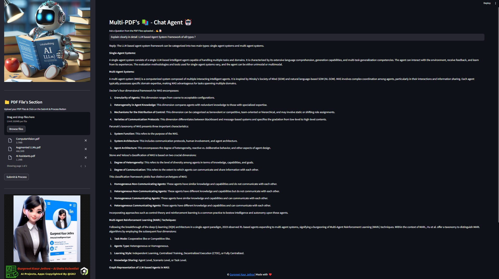
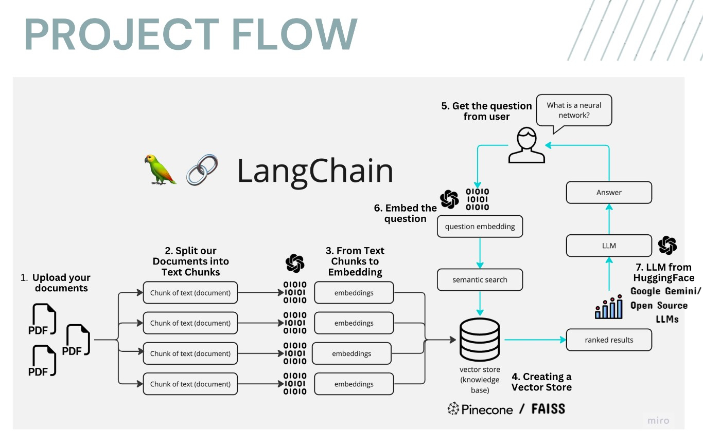
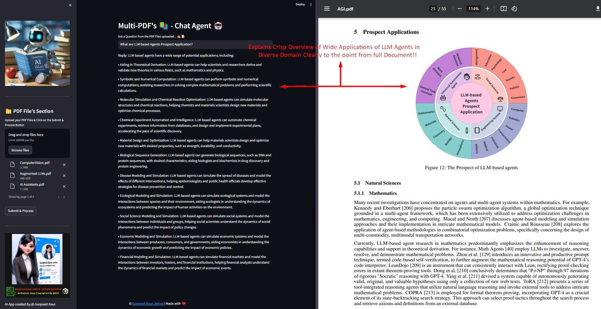
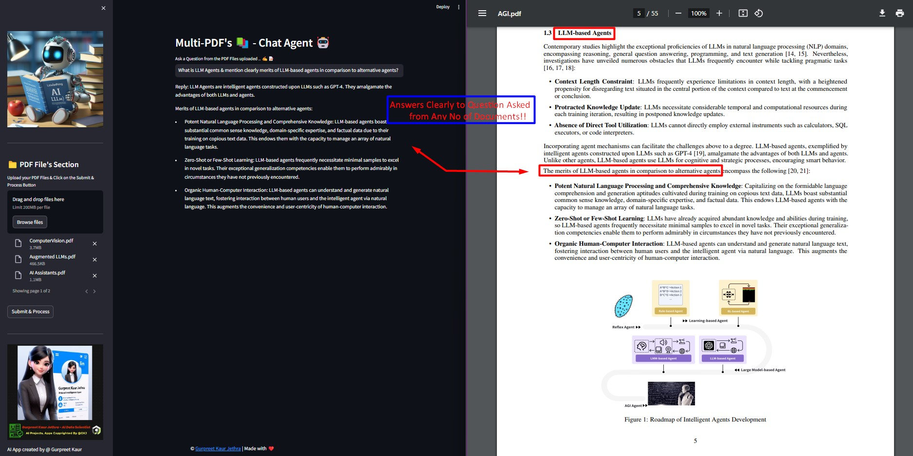
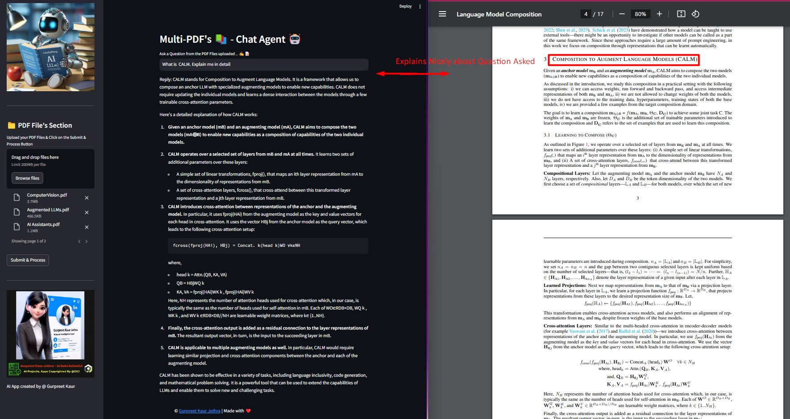

# Multi-PDF-s 📚ChatApp AI Agent 🤖

Meet MultiPDF Chat AI App! 🚀 Chat seamlessly with Multiple PDFs using LangChain, local HuggingFace embeddings, Groq (Llama 3.3) &amp; FAISS Vector DB with seamless Streamlit deployment. Get instant, accurate responses grounded in your documents. 📚💬 Transform your PDF experience now! 🔥✨

> **Tech stack:** Streamlit · LangChain · HuggingFace `sentence-transformers` (local embeddings, no API key) · Groq `llama-3.3-70b-versatile` (chat) · FAISS (vector search)

## 📝 Description
The Multi-PDF's Chat Agent is a Streamlit-based web application designed to facilitate interactive conversations with a chatbot. The app allows users to upload multiple PDF documents, extract text information from them, and train a chatbot using this extracted content. Users can then engage in real-time conversations with the chatbot.

## 📢Demo App with Streamlit Cloud (Visualize only)


## 💻 Demo:


## 🎯 How It Works:
------------



The application follows these steps to provide responses to your questions:

1. **PDF Loading** : The app reads multiple PDF documents and extracts their text content.

2. **Text Chunking** : The extracted text is divided into smaller chunks that can be processed effectively.

3. **Embeddings (local)** : A local HuggingFace `sentence-transformers` model generates vector representations (embeddings) of the text chunks. This runs on your machine with no API key and no rate limits.

4. **Similarity Matching** : When you ask a question, the app compares it with the text chunks in the FAISS index and identifies the most semantically similar ones.

5. **Response Generation** : The selected chunks are passed as context to the Groq-hosted Llama 3.3 model, which generates a response based on the relevant content of the PDFs.



--- 
## 🎯 Key Features

- **Adaptive Chunking**: Our Sliding Window Chunking technique dynamically adjusts window size and position for RAG, balancing fine-grained and coarse-grained data access based on data complexity and context.

- **Multi-Document Conversational QA**: Supports simple and multi-hop queries across multiple documents simultaneously, breaking the single-document limitation.

- **File Compatibility**: Supports both PDF and TXT file formats.

- **No embedding rate limits**: Embeddings run locally via HuggingFace `sentence-transformers`, so processing large or multiple PDFs never hits an API quota.

- **Fast, free chat**: Chat responses are generated by Groq's Llama 3.3 model, which offers a generous free tier.





## 🌟Requirements

- **streamlit** : Python library for building the interactive web UI.
- **python-dotenv** : Loads environment variables (like your API key) from a `.env` file so secrets stay out of the code.
- **langchain / langchain-core / langchain-community / langchain-text-splitters** : Core framework for text splitting, vector stores, prompts, and chat model integration.
- **langchain-huggingface** + **sentence-transformers** : Runs the embedding model locally (`sentence-transformers/all-MiniLM-L6-v2`). No API key, no rate limits.
- **langchain-groq** : Integration with Groq's hosted LLMs. Provides the `ChatGroq` chat model used to answer questions.
- **PyPDF2** : Reads and extracts text from PDF files.
- **faiss-cpu** : FAISS (Facebook AI Similarity Search) for efficient similarity search over the document embeddings.


---

## ▶️Installation

Clone the repository:

```
git clone https://github.com/praveenrathod12/MultiPdfs-ChatApp-AI-Agent.git
```

(Recommended) create and activate a virtual environment, then install the required Python packages:

```
python -m venv .venv
# Windows:
.venv\Scripts\activate
# macOS/Linux:
source .venv/bin/activate

pip install -r requirements.txt
```

Get a **free Groq API key** from [console.groq.com](https://console.groq.com), then create a `.env` file in the project root with:

```
GROQ_API_KEY=your-groq-api-key-here
```

> Note: The embedding model runs locally and needs no key. Only the chat step uses Groq.
> On first run, the embedding model (~90 MB) downloads automatically and is cached.

Run the Streamlit app (the main file is `chatapp.py`):

```
streamlit run chatapp.py
```

---
## 💡Usage

To use the Multi-PDF-s 📚ChatApp AI Agent 🤖, U can have glimpse of look by clicking on this link : [Launch App On Streamlit](https://multi-pdfschatappai-agent.streamlit.app/). To run app, fork app and follow the below steps to start using it. Use the sidebar to upload PDF files and train the chatbot. Once trained, you can have conversations with the chatbot by entering questions in the text input field.

In case You want to run & implement project on your system then follow these steps:

1. Ensure that you have installed the required dependencies and added your **Groq API key to the `.env` file** (MUST).
2. Run the `chatapp.py` file using the Streamlit CLI. Execute the following command:
   ```
   streamlit run chatapp.py
   ```
3. The application will launch in your default web browser, displaying the user interface.
4. Upload multiple PDF documents into the app by following the provided instructions at sidebar. On the sidebar, you'll find an option to upload PDF documents. Click on the "Upload your documents here and click on Process" button and select one or more PDF files. 
5. Don't forget to click on Submit & Process Button.
6. Ask questions in natural language about the loaded PDFs using the chat interface.
7. Chatting with the Documents: After uploading and processing the PDF documents, you can ask questions by typing them in the text input field. Press Enter or click the "Ask" button to submit your question.

The application will use conversational AI to provide responses based on the content of the uploaded documents. The responses will be displayed in the chat interface.

---

## 🚀 Deploy a Live Demo (Streamlit Community Cloud)

You can host a free public demo of this app:

1. Push the project to a **public GitHub repository**. The `.gitignore` already excludes your `.env`, so your API key stays private.
2. Go to [share.streamlit.io](https://share.streamlit.io) and sign in with GitHub.
3. Click **Create app** → deploy from your repo, choosing branch `main` and main file **`chatapp.py`**.
4. Under **Advanced settings → Secrets**, add your key:
   ```
   GROQ_API_KEY = "your-groq-api-key-here"
   ```
5. Click **Deploy**. You'll get a public URL like `https://<your-app>.streamlit.app`.

Notes:
- The local embedding model downloads on first boot, so the very first load is slower.
- Free Streamlit apps sleep after inactivity and take a few seconds to wake up.

---

